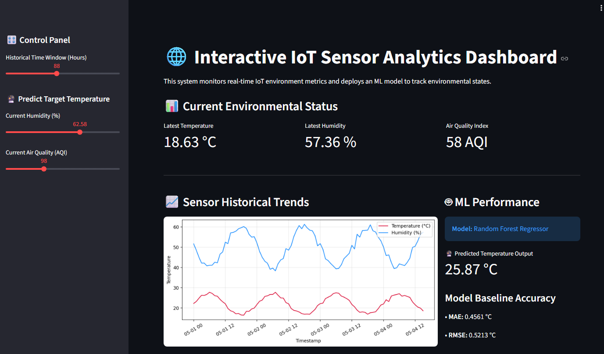
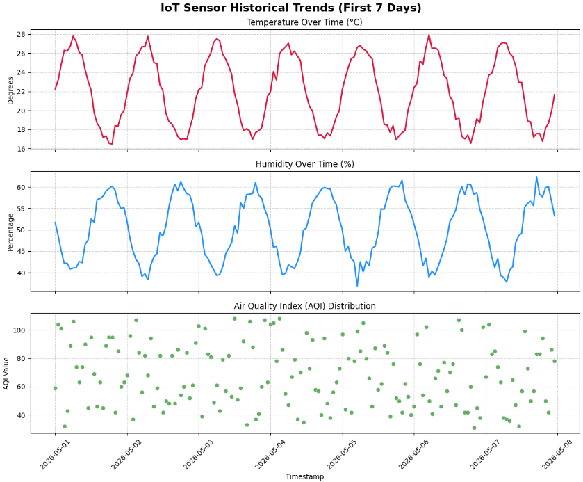

# IoT Sensor Analytics & ML Dashboard

An interactive IoT data analytics and machine learning project for analyzing environmental sensor telemetry and predicting temperature using a **Random Forest Regressor**.

The project demonstrates an end-to-end workflow covering synthetic IoT data generation, preprocessing, exploratory data analysis, machine learning, model evaluation, and an interactive **Streamlit** dashboard.



## Project Overview

Raw IoT telemetry can be difficult to interpret without processing and visualization. This project transforms environmental sensor readings into meaningful trends and uses machine learning to predict temperature from current environmental conditions.

The dataset contains **1,000 hourly observations** with four fields:

- `Timestamp`
- `Temperature`
- `Humidity`
- `Air_Quality`

The machine learning model uses **Humidity** and **Air Quality Index (AQI)** as input features and **Temperature** as the prediction target.

## Features

- Synthetic environmental IoT dataset generation
- Data preprocessing and validation
- Exploratory Data Analysis (EDA)
- Historical sensor trend visualization
- Random Forest regression model
- Temperature prediction from humidity and AQI
- MAE and RMSE model evaluation
- Interactive Streamlit dashboard
- Adjustable 24–168 hour historical view
- Interactive humidity and AQI inputs

## Sensor Data Trends

The generated data simulates environmental behavior over time. Temperature follows a daily sinusoidal cycle with random variation, while humidity follows an inverse cycle. AQI varies independently to introduce a noisy environmental feature.



## Machine Learning Model

The project uses a **Random Forest Regressor** with 100 decision trees.

**Input features:**
- Humidity
- Air Quality Index

**Target:**
- Temperature

The dataset is split into **80% training data** and **20% testing data**.

Model performance is evaluated using:

- **Mean Absolute Error (MAE)**
- **Root Mean Squared Error (RMSE)**

The original project evaluation achieved approximately:

| Metric | Result |
| --- | ---: |
| MAE | 0.4561 °C |
| RMSE | 0.5213 °C |

The GitHub version of the Streamlit application uses the trained Random Forest model directly for interactive temperature predictions.

## Technologies Used

- Python
- Pandas
- NumPy
- Matplotlib
- Scikit-learn
- Streamlit
- Jupyter Notebook / Google Colab

## Project Structure

```text
iot-sensor-analytics-dashboard/
├── README.md
├── app.py
├── IoT_Analytics_Project.ipynb
├── requirements.txt
├── .gitignore
├── data/
│   └── iot_sensor_data.csv
├── screenshots/
│   ├── dashboard.png
│   └── sensor_trends.png
└── docs/
    └── IoT_Project_Report.pdf
```

## Installation

Clone the repository:

```bash
git clone https://github.com/YOUR-USERNAME/iot-sensor-analytics-dashboard.git
cd iot-sensor-analytics-dashboard
```

Install the required packages:

```bash
pip install -r requirements.txt
```

## Run the Dashboard

The application is already configured to load the dataset from the `data/` directory.

Start Streamlit:

```bash
streamlit run app.py
```

Streamlit will provide a local address that you can open in your browser.

## Dashboard Capabilities

The dashboard allows users to:

- View the latest temperature, humidity, and AQI readings
- Adjust the historical display window from 24 to 168 hours
- Visualize historical environmental trends
- Enter humidity and AQI values
- Generate a temperature prediction using the trained Random Forest model
- Review MAE and RMSE performance metrics

## Dataset

The dataset is synthetically generated to make the project fully reproducible without requiring physical IoT hardware.

It contains 1,000 continuous hourly records beginning on May 1, 2026. A fixed NumPy random seed is used so the generated dataset can be reproduced consistently.

## Future Improvements

Possible extensions include:

- Connect physical IoT sensors through MQTT
- Process live sensor streams
- Add additional environmental sensor types
- Deploy the Streamlit dashboard online
- Compare Random Forest with other regression algorithms
- Explore LSTM models for time-series forecasting
- Add automated environmental alerts and feedback systems

## Documentation

The `docs/` directory contains the full project report describing the dataset, preprocessing workflow, exploratory analysis, machine learning model, evaluation metrics, dashboard architecture, and proposed future improvements.

## Author

Developed as an IoT data analytics and machine learning project for educational and portfolio purposes.
